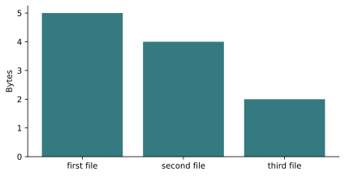

# Quoting paths and expanding globs

Count bytes in three files whose names contain spaces.

A quoted parameter expands to one argument even if its value contains spaces. A pathname pattern expands to matching pathnames. Keep the pattern outside the quotes while quoting its directory prefix.

[Worked notebook](lesson.ipynb) · [Python script](lesson.py)

[example.sh](example.sh)

## Run the shell script

The Python driver gives each installed shell its own empty working directory. Each run must agree with the independently specified fixture.

## Inspect the outcome

A filename is data. A shell variable used as a filename should normally be quoted.

## Recorded output

```text
sh [5, 4, 2]
bash [5, 4, 2]
zsh [5, 4, 2]
```

## Interpreting the result

A filename is data. A shell variable used as a filename should normally be quoted.



## Exercise

Add a filename containing brackets and run the example without changing the command.

## References

[The Open Group, POSIX shell command language](https://pubs.opengroup.org/onlinepubs/9799919799/utilities/V3_chap02.html)

[GNU Bash reference manual](https://www.gnu.org/software/bash/manual/bash.html)

[Apple Terminal User Guide](https://support.apple.com/guide/terminal/welcome-trml2df0220c/mac)
