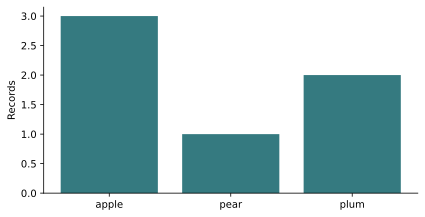

# Pipelines and grouped counts

Count repeated labels with a portable text-processing pipeline.

uniq counts adjacent equal lines. Sorting first makes every occurrence of a class adjacent. LC_ALL=C fixes the collation order for this ASCII fixture.

[Worked notebook](lesson.ipynb) · [Python script](lesson.py)

[example.sh](example.sh)

## Run the shell script

The Python driver gives each installed shell its own empty working directory. Each run must agree with the independently specified fixture.

## Inspect the outcome

The population size equals the sum of the counts. Removing sort changes the question to run-length counting.

## Recorded output

```text
sh [3, 1, 2]
bash [3, 1, 2]
zsh [3, 1, 2]
```

## Interpreting the result

The population size equals the sum of the counts. Removing sort changes the question to run-length counting.



## Exercise

Reorder the input and confirm that the sorted pipeline gives the same counts.

## References

[The Open Group, POSIX shell command language](https://pubs.opengroup.org/onlinepubs/9799919799/utilities/V3_chap02.html)

[GNU Bash reference manual](https://www.gnu.org/software/bash/manual/bash.html)

[Apple Terminal User Guide](https://support.apple.com/guide/terminal/welcome-trml2df0220c/mac)
