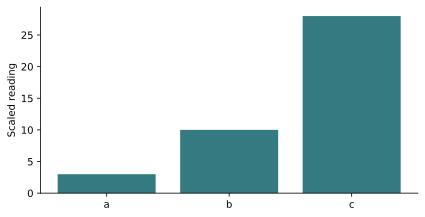

# Joining two tables

Join a key-value table to a small lookup table and retain one row per matching key.

Both inputs must be sorted on the join field under the same collation rules. A join can multiply rows when a key is repeated on either side. Here each key appears once on each side.

[Worked notebook](lesson.ipynb) · [Python script](lesson.py)

[example.sh](example.sh)

## Run the shell script

The Python driver gives each installed shell its own empty working directory. Each run must agree with the independently specified fixture.

## Inspect the outcome

The output order follows the sorted join key. A missing key drops out of this inner join.

## Recorded output

```text
sh [3, 10, 28]
bash [3, 10, 28]
zsh [3, 10, 28]
```

## Interpreting the result

The output order follows the sorted join key. A missing key drops out of this inner join.



## Exercise

Remove one lookup row and compare the output with a left join.

## References

[The Open Group, POSIX shell command language](https://pubs.opengroup.org/onlinepubs/9799919799/utilities/V3_chap02.html)

[GNU Bash reference manual](https://www.gnu.org/software/bash/manual/bash.html)

[Apple Terminal User Guide](https://support.apple.com/guide/terminal/welcome-trml2df0220c/mac)
