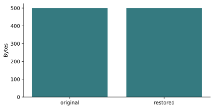

# Streams and gzip round trips

Check that compression followed by decompression recovers the exact original bytes.

Compressed length depends on the compressor and options. A byte comparison evaluates the stronger property needed here, preservation of the entire input. Input through standard input avoids embedding a source filename.

[Worked notebook](lesson.ipynb) · [Python script](lesson.py)

[example.sh](example.sh)

## Run the shell script

The Python driver gives each installed shell its own empty working directory. Each run must agree with the independently specified fixture.

## Inspect the outcome

Equal byte counts alone do not prove equality. cmp performs the full byte comparison.

## Recorded output

```text
sh [500, 500]
bash [500, 500]
zsh [500, 500]
```

## Interpreting the result

Equal byte counts alone do not prove equality. cmp performs the full byte comparison.



## Exercise

Alter one byte after restoration, keep the length unchanged and observe the comparison exit status.

## References

[The Open Group, POSIX shell command language](https://pubs.opengroup.org/onlinepubs/9799919799/utilities/V3_chap02.html)

[GNU Bash reference manual](https://www.gnu.org/software/bash/manual/bash.html)

[Apple Terminal User Guide](https://support.apple.com/guide/terminal/welcome-trml2df0220c/mac)
