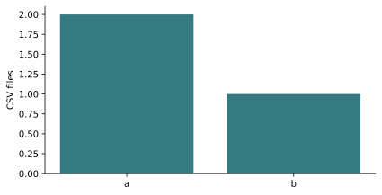

# Finding files by type and suffix

Compare matching file counts across two branches of a temporary directory tree.

find applies each predicate to each entry. Grouping by a directory is easy here because each argument names a separate subtree. A quoted pattern is passed to find for matching.

[Worked notebook](lesson.ipynb) · [Python script](lesson.py)

[example.sh](example.sh)

## Run the shell script

The Python driver gives each installed shell its own empty working directory. Each run must agree with the independently specified fixture.

## Inspect the outcome

The records counted by wc contain a constant marker. A newline in a matched filename cannot create a spurious count.

## Recorded output

```text
sh [2, 1]
bash [2, 1]
zsh [2, 1]
```

## Interpreting the result

The records counted by wc contain a constant marker. A newline in a matched filename cannot create a spurious count.



## Exercise

Put a CSV file one level deeper and compare recursive and top-level counts.

## References

[The Open Group, POSIX shell command language](https://pubs.opengroup.org/onlinepubs/9799919799/utilities/V3_chap02.html)

[GNU Bash reference manual](https://www.gnu.org/software/bash/manual/bash.html)

[Apple Terminal User Guide](https://support.apple.com/guide/terminal/welcome-trml2df0220c/mac)
