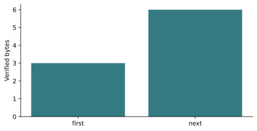

# Archives and verified extraction

Archive two known files, restore into a new temporary destination and check the restored bytes.

Each path used for archiving is relative to the fixture root. The extraction directory starts empty. This lab handles an archive just created from known inputs.

[Worked notebook](lesson.ipynb) · [Python script](lesson.py)

[example.sh](example.sh)

## Run the shell script

The Python driver gives each installed shell its own empty working directory. Each run must agree with the independently specified fixture.

## Inspect the outcome

A list of archive member names establishes inventory. Comparing the extracted files tests the contents directly.

## Recorded output

```text
sh [3, 6]
bash [3, 6]
zsh [3, 6]
```

## Interpreting the result

A list of archive member names establishes inventory. Comparing the extracted files tests the contents directly.



## Exercise

Add a file in a subdirectory and carry the same integrity check through the restore.

## References

[The Open Group, POSIX shell command language](https://pubs.opengroup.org/onlinepubs/9799919799/utilities/V3_chap02.html)

[GNU Bash reference manual](https://www.gnu.org/software/bash/manual/bash.html)

[Apple Terminal User Guide](https://support.apple.com/guide/terminal/welcome-trml2df0220c/mac)
