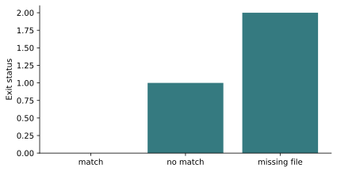

# Exit status and conditional execution

Observe matching, nonmatching and missing input through grep exit codes.

A nonmatch is an expected outcome in a search. A missing file is an operational error. Test the distinction explicitly. Commands in if conditions can be inspected without treating every nonzero return as a fatal shell error.

[Worked notebook](lesson.ipynb) · [Python script](lesson.py)

[example.sh](example.sh)

## Run the shell script

The Python driver gives each installed shell its own empty working directory. Each run must agree with the independently specified fixture.

## Inspect the outcome

The POSIX guarantee for an error is a status greater than one. GNU and BSD grep normally return two here. The verification accepts any error status above one.

## Recorded output

```text
sh [0, 1, 2]
bash [0, 1, 2]
zsh [0, 1, 2]
```

## Interpreting the result

The POSIX guarantee for an error is a status greater than one. GNU and BSD grep normally return two here. The verification accepts any error status above one.



## Exercise

Use a conditional branch to report a nonmatch without hiding a genuine input error.

## References

[The Open Group, POSIX shell command language](https://pubs.opengroup.org/onlinepubs/9799919799/utilities/V3_chap02.html)

[GNU Bash reference manual](https://www.gnu.org/software/bash/manual/bash.html)

[Apple Terminal User Guide](https://support.apple.com/guide/terminal/welcome-trml2df0220c/mac)
